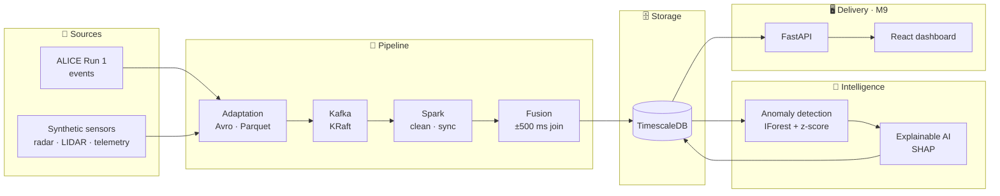
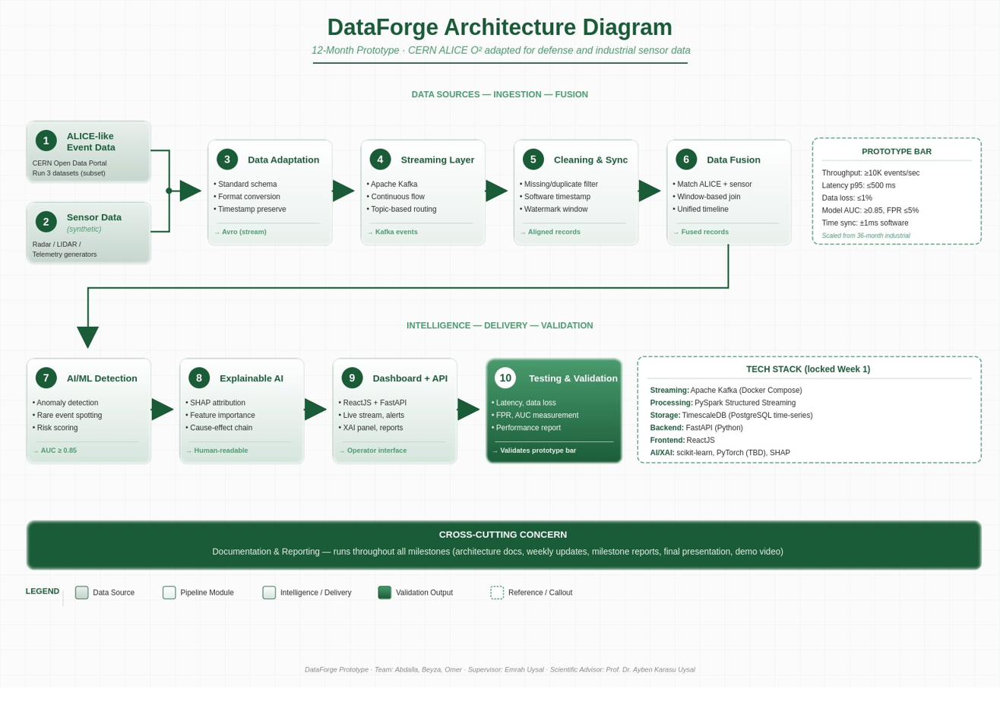

<div align="center">

# DataForge 🔬

**Real-time scientific and sensor data processing, with anomaly detection you can explain.**

CERN ALICE collision events and radar, LIDAR and telemetry streams go in.<br>
Fused, scored and explained events come out.

[](https://github.com/Jeylani-2526/dataforge/actions/workflows/ci.yml)
[](#-where-we-stand)
[](#-at-a-glance)
[](https://www.python.org/)
[](docker-compose.yml)
[](LICENSE)

[How it works](#-how-it-works) ·
[Where we stand](#-where-we-stand) ·
[Quick start](#-quick-start) ·
[Modules](#-modules) ·
[Docs](#-documentation-map) ·
[Contributing](#-contributing)

</div>

---

## 📌 At a glance

- **Ingests** CERN ALICE Run 1 event data and synthetic radar, LIDAR and telemetry streams.
- **Streams and cleans** them through Kafka and PySpark Structured Streaming, with event-time watermarks.
- **Fuses** the streams onto one timeline (±500 ms join window) and stores the result in TimescaleDB.
- **Detects anomalies** with an Isolation Forest plus robust z-score model, and **explains** each alarm with SHAP.

> [!NOTE]
> DataForge is a **TRL 4–5 research prototype**. It is built to prove that the pipeline and the AI logic are
> correct on laptop hardware with Docker Compose. It is not a production deployment.

### 🧭 Why ALICE O²?

ALICE O² (Online–Offline) is CERN's system for processing millions of particle collisions per second, in
parallel and with fault tolerance. Radar, LIDAR and telemetry sensors produce the same kind of continuous,
time-sensitive, event-like data. DataForge adapts that proven scientific architecture to industrial and
defence sensor systems.

---

## 🔧 How it works



| Stage | What happens |
|---|---|
| 📡 **Sources** | ALICE events are pulled from the CERN Open Data Portal. Python generators produce sensor streams with labelled, injected anomalies. |
| 🔄 **Adaptation** | Records are validated against versioned Avro schemas and stored as Parquet. |
| 🚚 **Streaming** | Kafka carries each source on its own topic. Spark cleans and windows them on event time. |
| 🔗 **Fusion** | ALICE and sensor events are joined into `fused_events`, with checkpointed, replay-safe writes. |
| 🧠 **Detection** | Each stream gets a 0–1 `risk_score`, an alarm line at a 1% false-alarm budget, and a confidence value. |
| 💬 **Explanation** | Every alarm gets the features that drove it, their direction, and a sentence an operator can read. |
| 🖥️ **Delivery** | A FastAPI backend and a React dashboard show live alerts and their explanations (M9). |

<details>
<summary><b>Full architecture diagram</b></summary>
<br>



The written description is in [`docs/architecture/ARCHITECTURE.md`](docs/architecture/ARCHITECTURE.md), and module ownership is in
[`module_ownership_map.md`](docs/architecture/module_ownership_map.md).

</details>

---

## 📊 Where we stand

**Now:** M8 · Explainable AI, 23 November – 20 December 2026.
The plan is in [`m8_kickoff_notes.md`](docs/milestones/milestone7/m8_kickoff_notes.md).

| # | Milestone | Dates | Status |
|---|---|---|---|
| M1 | Project Understanding & Requirements | 11 May – 7 Jun 2026 | ✅ Completed |
| M2 | Data Schema & Model Design | 8 Jun – 5 Jul 2026 | ✅ Completed |
| M3 | Data Generation & Preprocessing | 6 Jul – 2 Aug 2026 | ✅ Completed |
| M4 | Data Adaptation Layer | 3 Aug – 30 Aug 2026 | ✅ Completed, with open items |
| M5 | Streaming Pipeline | 31 Aug – 27 Sep 2026 | ✅ Completed, with open items |
| M6 | Data Fusion & Synchronization | 28 Sep – 8 Nov 2026 | ✅ Completed, with open items |
| M7 | AI/ML Anomaly Detection | 2 Nov – 22 Nov 2026 | ✅ Completed, with open items |
| **M8** | **Explainable AI Layer** | **23 Nov – 20 Dec 2026** | **🔄 In progress** |
| M9 | Dashboard, API & Integration | 21 Dec 2026 – 14 Feb 2027 | ⏳ Upcoming |
| M10 | Testing & Final Delivery | 15 Feb – 9 Apr 2027 | ⏳ Upcoming |

The week-by-week plan is in the [Roadmap document](docs/milestones/DataForge_Roadmap.docx), and every milestone package is listed in
[`docs/milestones/`](docs/milestones/).

### 🎯 Prototype performance bar

These targets were agreed with the project supervisor for laptop-Docker hardware. They are **not** the
industrial targets of the full 36-month proposal. "Completed" on a milestone does not mean every bar is met:
gaps are measured, given a named cause, and carried forward to M10.

| Metric | Target | Latest measured | Status |
|---|---|---|---|
| Data loss | ≤ 1% | 0.0% (M5, M6) | ✅ Met |
| Model AUC | ≥ 0.85 | 0.997 pooled, 0.992 worst stream (M7) ¹ | ✅ Met |
| False-positive rate | ≤ 5% | 0.88% pooled, 0.94% worst stream (M7) ¹ | ✅ Met |
| Throughput | ≥ 10,000 events/sec | 1,417 events/sec like-for-like, ~3,650 pipeline capacity (M5) | ⚠️ Not met → M10 |
| Latency (p95) | ≤ 500 ms | 5.7 s streaming (M5), 19.3 s fused path (M6), structural to the trigger interval | ⚠️ Not met → M10 |
| Time sync (software) | ± 1 ms | p95 96 ms, from sensor event spacing rather than clock error (M6) | ⚠️ Not met → M10 |

¹ Measured on **synthetic** anomalies.

<details>
<summary><b>Milestone notes, M4 – M7</b></summary>

#### M4 · Data Adaptation Layer
- **Delivered:** the adaptation layer, schema-versioning enforcement, format conversion, staging-to-production promotion and TimescaleDB port-config fixes. Marked Completed after the M5 review on 30 September 2026.
- **Carried forward:** the throughput bar, now tracked as M5 Open Item 1. Items 1, 3 and 4 remain open.
- **Details:** [`m4_package_cover_note.md`](docs/milestones/milestone4/m4_package_cover_note.md) and [`open_items_m4.md`](docs/milestones/milestone4/open_items_m4.md).

#### M5 · Streaming Pipeline
- **Delivered:** live Kafka (KRaft) producers on all four topics, the Spark Structured Streaming consumer with event-time watermarks and windows, schema-versioning enforcement on every streamed record, and the throughput benchmark with its root-cause fix. Accepted at the review on 30 September 2026.
- **Carried forward:** throughput (Open Item 1) and end-to-end latency (Open Item 6). Open Items 2 and 9, checkpointing and clean shutdown, were resolved in M6W21T2.
- **Details:** [`m5_package_cover_note.md`](docs/milestones/milestone5/m5_package_cover_note.md), [`m5_validation_report.md`](docs/milestones/milestone5/m5_validation_report.md) and [`open_items_m5.md`](docs/milestones/milestone5/open_items_m5.md).

#### M6 · Data Fusion & Synchronization
- **Delivered:** live fusion of the ALICE and sensor streams with a ±500 ms join window, checkpointed and replay-safe writes to `fused_events`, conformance PASS and 100% fused-reference resolution, with zero duplicates and zero watermark drops. Closed on 8 November 2026 after an 18-day pause.
- **Carried forward:** fused-path latency (Open Item 5) and timestamp alignment.
- **Details:** [`m6_package_cover_note.md`](docs/milestones/milestone6/m6_package_cover_note.md) and [`open_items_m6.md`](docs/milestones/milestone6/open_items_m6.md).

#### M7 · AI/ML Anomaly Detection
- **Delivered:** model v2 per stream (Isolation Forest plus a per-feature robust z-score, with telemetry integrity rules), the evaluation report, the baseline comparison, and batch scoring of 12,123 aligned fused rows verified by SQL. Closed on 22 November 2026.
- **Carried forward:** live scoring inside the fusion stream moves to M8, and the PyTorch deep model is deferred to M10.
- **Details:** [`m7_package_cover_note.md`](docs/milestones/milestone7/m7_package_cover_note.md), [`m7_evaluation_report.md`](docs/milestones/milestone7/m7_evaluation_report.md) and [`open_items_m7.md`](docs/milestones/milestone7/open_items_m7.md).

GitHub tags mark each milestone close, for example `M6-W26-abdalla`, `M6-W26-beyza` and `M6-W26-omer`.

</details>

---

## 🚀 Quick start

### Prerequisites

| Tool | Version |
|---|---|
| Docker Desktop | 4.x or later, running |
| Git | any recent version |
| Python | 3.11 or later (for the ML scripts and tests) |
| Java | 17 (only for running the PySpark tests outside Docker) |

### 1. Clone and configure

```bash
git clone https://github.com/Jeylani-2526/dataforge.git
cd dataforge
cp .env.example .env    # the defaults work for local development
```

### 2. Start the infrastructure

```bash
docker compose up -d
```

With no profile flags, Compose starts only the always-on services:

| Service | Address | Notes |
|---|---|---|
| Kafka | `localhost:9092` | KRaft mode, no ZooKeeper |
| Kafka UI | http://localhost:8080 | Browse topics and messages |
| TimescaleDB | `localhost:5433` | Mapped to 5433 on the host so it does not clash with a local PostgreSQL. Inside the Docker network it is `timescaledb:5432` |
| Adminer | http://localhost:8081 | Database UI. Server `timescaledb`, user and password from `.env` |

### 3. Start the pipeline

Each pipeline service sits behind a milestone profile. Profiles do not cascade, so list every one you need:

```bash
docker compose \
  --profile m3-and-above --profile m4-and-above \
  --profile m5-and-above --profile m6-and-above \
  up --build -d
```

| Profile | Adds |
|---|---|
| `m3-and-above` | `sensor-generators` |
| `m4-and-above` | `adaptation-layer` |
| `m5-and-above` | `alice-ingestion`, `spark-processor` |
| `m6-and-above` | `fusion-engine` |
| `m7-and-above` · `m8-and-above` | Placeholders. M7 and M8 code runs from `services/ml/` (step 4) |
| `m9-and-above` | `api` on http://localhost:8000 and `dashboard` on http://localhost:3000, arriving in M9 |

> [!WARNING]
> **Restarting `alice-ingestion` while `spark-processor` keeps running** makes the windowed ALICE counts
> drop records as late. Restarting only `spark-processor` does not fix it, because its checkpoint
> restores the saved watermark (M5 Open Item 8). Use this order:
>
> ```bash
> docker compose stop spark-processor
> docker compose restart alice-ingestion
> docker compose run --rm --no-deps --entrypoint sh spark-processor -c "rm -rf /app/checkpoints/alice_throughput"
> docker compose up -d spark-processor
> ```
>
> Staging writes and the fusion join are not affected.

### 4. Train the model and score fused events

```bash
pip install -r services/ml/requirements.txt

# Train model v2. The .joblib files are not committed, so every machine builds its own.
python services/ml/model_v2.py train

# Score fused rows from a point in time. Add --dry-run to report without writing.
python services/ml/batch_score.py --since 2026-11-12T07:06:00Z
```

The scripts connect to `localhost:5433` with the default credentials from `.env.example`.

---

## 🧪 Running tests

Each service keeps its own `requirements.txt`. Install the ones you need, then run pytest from the repo root.
This matches what CI runs:

```bash
pip install pytest \
  -r services/adaptation-layer/requirements.txt \
  -r services/streaming/spark/requirements.txt \
  -r services/ml/requirements.txt

pytest services/ -v
```

> [!TIP]
> The Spark and fusion tests need **Java 17**. PySpark 3.5 fails on Java 23 and later.

CI ([`ci.yml`](.github/workflows/ci.yml)) runs on every push and pull request to `develop` and `main`. It runs flake8,
validates `docker-compose.yml` and runs the Python tests. JavaScript lint switches on once the dashboard lands in M9.

---

## 🧩 Modules

| # | Module | Folder | Tech | Status |
|---|---|---|---|---|
| 1 | 📡 ALICE event ingestion | [`services/data-sources/alice-ingestion/`](services/data-sources/alice-ingestion/) | CERN Open Data Portal (Run 1) | ✅ |
| 2 | 📡 Sensor generators | [`services/data-sources/sensor-generators/`](services/data-sources/sensor-generators/) | Python: radar, LIDAR, telemetry | ✅ |
| 3 | 🔄 Data adaptation | [`services/adaptation-layer/`](services/adaptation-layer/) | Avro, Parquet, versioned schemas | ✅ |
| 4 | 🚚 Streaming | [`docker-compose.yml`](docker-compose.yml) | Apache Kafka (Confluent `cp-kafka` 7.6, KRaft) | ✅ |
| 5 | 🧹 Cleaning & sync | [`services/streaming/spark/`](services/streaming/spark/) | PySpark 3.5 Structured Streaming, watermarks | ✅ |
| 6 | 🔗 Data fusion | [`services/fusion/`](services/fusion/) | PySpark window join, TimescaleDB | ✅ |
| 7 | 🧠 Anomaly detection | [`services/ml/`](services/ml/) | scikit-learn: Isolation Forest + robust z-score | ✅ |
| 8 | 💬 Explainable AI | [`services/ml/`](services/ml/) | SHAP | 🔄 M8 |
| 9 | 🖥️ Dashboard & API | [`services/dashboard/`](services/dashboard/) | FastAPI, React | ⏳ M9, specs and wireframes ready |
| 10 | ✅ Testing & validation | [`services/testing/`](services/testing/) | pytest, Locust, custom performance harness | ⏳ M10 |

**Storage:** TimescaleDB 2.x on PostgreSQL 16 · **Serialization:** Apache Avro, Parquet ·
**Infrastructure:** Docker Compose

---

## 📁 Repository layout

```text
dataforge/
├── .github/               CI workflow, issue templates, PR template
├── data/                  ALICE and synthetic samples, training splits, alignment output
├── docs/                  Architecture, requirements, schemas, database, API, milestones
├── infrastructure/
│   ├── docker/            One Dockerfile per service
│   └── scripts/           init-db.sql and database migrations
├── schemas/               Avro schemas (.avsc), test records, schema validator
├── scripts/               Data quality checks and one-off generators
├── services/
│   ├── data-sources/      Modules 1–2: alice-ingestion, sensor-generators
│   ├── adaptation-layer/  Module 3
│   ├── streaming/spark/   Module 5
│   ├── fusion/            Module 6
│   ├── ml/                Modules 7–8: features, models, scoring, XAI
│   ├── dashboard/         Module 9: backend, frontend, specs, wireframes
│   ├── testing/           Module 10
│   └── ai-ml/             Retired stubs (M8 decision D4). Code lives in services/ml/
├── .env.example           Environment variable template
├── docker-compose.yml     Full-stack orchestration with milestone profiles
└── CONTRIBUTING.md        Branching, commits, PR process
```

---

## 📚 Documentation map

| Looking for… | Go to |
|---|---|
| Architecture and module ownership | [`docs/architecture/`](docs/architecture/) |
| Requirements and the prototype bar | [`docs/requirements/`](docs/requirements/) |
| Data specs, ALICE field inventory, anomaly injection | [`docs/data/`](docs/data/) |
| Avro schema specs | [`docs/schemas/`](docs/schemas/) |
| Database ERD, tables and contracts | [`docs/database/`](docs/database/) |
| API contracts for the dashboard | [`docs/api/`](docs/api/) |
| Milestone packages and open items | [`docs/milestones/`](docs/milestones/) |
| Testing strategy | [`docs/Dataforge Testing Strategy.md`](<docs/Dataforge Testing Strategy.md>) |
| Glossary | [`docs/glossary.md`](docs/glossary.md) |

---

## 👥 Team

| Member | Role | Focus |
|---|---|---|
| **Abdalla** | Project lead | Architecture, AI/ML, XAI, documentation, coordination |
| **Beyza** | Full-stack developer | TimescaleDB, FastAPI, React dashboard, UI/UX |
| **Omer** | Data engineer | Kafka, Spark, Docker, data simulation, performance testing |

**Supervisor:** Emrah Uysal, Dataseed Yazılım Elektronik<br>
**Scientific advisor:** Prof. Dr. Ayben Karasu Uysal, Yıldız Teknik Üniversitesi

---

## 🤝 Contributing

The full guide is in [CONTRIBUTING.md](CONTRIBUTING.md). In short:

- Branch from `develop`. `main` and `develop` are both protected, and every change goes through a pull request.
- Work is tracked by task ID, `M<milestone>W<week>T<n>` (for example `M8W29T4`), which goes in the branch name and the commit message.
- Commit format: `type(scope): message`, for example `feat(kafka): add topic config for sensor stream`.
- Every PR needs at least one review before it merges into `develop`. `main` is updated at each milestone close.

---

## 📄 License

Released under the [MIT License](LICENSE).
